# Qumin — Quantitative Modeling in Non-Stationary Systems

**Most quantitative backtests—whether run by human researchers or autonomous AI coding agents—do not discover alpha. They overfit noise via temporal leakage, lookahead bias, and unpenalized multiple testing.**

**Qumin** (*Quantitative Modeling in Non-Stationary Systems*) is a local-first, perturbation-invariant quantitative research compiler and MCP (Model Context Protocol) execution harness. Built on rigorous financial econometrics (Fractional Differentiation, Purged Walk-Forward & Cross-Validation, Ledoit-Wolf Hierarchical Risk Parity, and the Deflated Sharpe Ratio), Qumin enforces strict epistemic governance across every stage of time-series modeling:

* **Mathematical Future-Blindness:** Verified by automated perturbation regression suites (`test_future_perturbation.py`) proving that altering market data after a fold cutoff changes zero bytes of historical features, fold-local preprocessors, or model weights.
* **Cryptographic Holdout Quarantine:** Reserves the holdout partition in an append-only SQLite ledger (`trials.sqlite`) *prior* to training. Candidate models are blocked from unsealing the holdout unless they strictly beat a non-trivial baseline out-of-fold and pass a multi-trial **Deflated Sharpe Ratio ($\text{DSR} \ge 0.95$)** threshold across all $K$ logged attempts.
* **Headless CLI & Agent-Ready MCP Server:** Exposes handle-based, token-budgeted tools over `stdio` so autonomous coding agents (Claude Code, Cursor) and human quants can execute multi-seed campaigns without contaminating test data.

> **[Try the 60-Second Null-Control Demo](#3-offline-demo):** Run `uv run qumin demo` offline to watch Qumin execute a 20-seed tournament on synthetic random-walk data, detect the data-snooping variance across $K=20$ trials, and automatically reject promotion (`REJECTED_BY_DSR`, leaving `seal: null`).

---

## 1. What Qumin Does

### Problems Addressed
Financial time series modeling is uniquely vulnerable to methodological flaws that invalidate research findings before deployment:

* **Lookahead and Information Leakage:** Fitting data scalers, computing global quantiles for clipping, or calculating features across an entire history allows future market regimes to alter historical inputs.
* **Overlapping Label Leakage:** Standard random K-fold cross-validation shuffles bars across time. When trade labels span multi-bar holding periods, future returns bleed directly into training sets.
* **Memory Destruction via First-Differencing:** Traditional econometric models take full integer differences ($d=1$) of prices to achieve stationarity, wiping out the series' long-term memory.
* **Selection Bias and P-Hacking:** Repeatedly testing models and allocations on the same holdout or test dataset turns statistical testing into an unpenalized search for noise patterns.
* **Execution Unreality:** Backtests that assume fills at the same bar-close price that produced the signal hide slippage and latency, producing phantom Sharpe ratios.

### Methodological Safeguards
Qumin replaces ad-hoc scripts with an auditable research harness:

* **Perturbation Invariance:** Validated by automated regression suites (`test_future_perturbation.py`), verifying that modifying data observed after a fold cutoff leaves past feature calculations, fold-fitted preprocessing state, and model decisions completely unchanged.
* **Memory-Preserving Stationarity:** Uses Fractional Differentiation (FFD) to find the minimum differencing order $d \in [0.1, 1.0]$ that passes the Augmented Dickey-Fuller (ADF) test, retaining long-term memory while achieving statistical stationarity.
* **Purged Walk-Forward Splits:** Enforces strict chronological order. Labels whose forward information horizon ($t_1$) overlaps an evaluation period are purged from the training fold.
* **Inner Early Stopping:** Splits an inner chronological subset from the training fold to calibrate training epochs or boosting rounds without ever viewing the fold's outer validation partition.
* **Audited Holdout Gate:** Enforces that candidates strictly outperform a non-trivial baseline on identical out-of-fold scoring keys and pass a Deflated Sharpe Ratio (DSR) threshold adjusted for the number of tested variations ($K$) before holdout evaluation is permitted.
* **Causal Execution Accounting:** Signals calculated at bar $t$ close are executed at bar $t+1$ open, with configurable transaction fees and slippage in basis points.

### What a Completed Run Produces
Every experiment produces a self-contained, reproducible record:
1. **An Immutable Run Directory (`artifacts/runs/<run_id>/`):** Contains exact input data slices (`snapshot/`), chronological fold bounds (`split.json`), fold-local preprocessor states (`preprocessors/`), out-of-fold predictions (`predictions.json`), metric summaries (`metrics.json`), trained model binaries (`models/`), backtest execution equity and trade event logs (`backtest/`), and a cryptographic manifest (`manifest.json`) verifying file checksums, configuration provenance, git commit hash, and dirty-tree identity.
2. **A SQLite Trial Record (`artifacts/trials.sqlite`):** An append-only log capturing trial settings, candidate tournament outcomes, and holdout gate decisions.
3. **A Standalone HTML Report (`artifacts/reports/<id>.html`):** An interactive diagnostic report displaying equity curves, drawdowns, candidate loss comparisons, comparable Sharpe distributions, and gate verdicts, indexed by an immutable JSON locator.

---

## 2. Setup

### System Prerequisites
* **Python:** Version $\ge 3.10$
* **Package Manager:** [`uv`](https://docs.astral.sh/uv/) (installed globally)
* **TA-Lib C-Library:** Required by `polars-talib` for fast technical indicators:
  * **macOS (Homebrew):**
    ```bash
    brew install ta-lib
    ```
  * **Linux / Debian:**
    ```bash
    wget http://prdownloads.sourceforge.net/ta-lib/ta-lib-0.4.0-src.tar.gz
    tar -xzf ta-lib-0.4.0-src.tar.gz && cd ta-lib
    ./configure --prefix=/usr && make && sudo make install
    ```
  * *Note on Docker:* When running within Docker, the library is compiled automatically during image build as specified in `Dockerfile`.

### Installation
Clone the repository and sync the locked dependencies including development tools:

```bash
cd qumin
uv sync --locked --extra dev
```

### Running Tests
Verify the installation by running the test suite. The project enforces an $80\%$ minimum test coverage threshold:

```bash
uv run pytest
```

### Supporting Services (Docker Compose)
To run the background Dagster pipeline orchestrator and the MLflow experiment tracking server:

```bash
# Start Dagster webserver (:3000), daemon, and MLflow (:5001)
make up

# Shut down background services
make down
```

### Hardware & Device Selection
Model acceleration is resolved dynamically based on hardware capabilities and explicit configuration in `config/pipeline.yaml` (`models.device`) or via environment variable using Pydantic's nested delimiter (`MODELS__DEVICE`):

```bash
# Force CPU execution
export MODELS__DEVICE=cpu

# Request Apple Silicon Metal Performance Shaders (for supported models)
export MODELS__DEVICE=mps
```

#### Device Support Matrix
| Model | CPU | Apple Silicon (`mps`) | NVIDIA CUDA (`cuda`) | Notes |
|---|:---:|:---:|:---:|---|
| **`baseline`** | Yes | No | No | Non-parametric; runs on CPU only. Requesting `mps` or `cuda` raises `ValueError`. |
| **`xgboost`** | Yes | No | Yes | `mps` is unsupported by XGBoost; requesting `mps` raises `ValueError`. |
| **`gru` / `lstm`** | Yes | Yes | Yes | Accelerated via PyTorch backend. |

> **Warning on Device Determinism:** Floating-point operations and reduction orders differ across CPU, MPS, and CUDA. While random seeds are set deterministically across libraries, bitwise identical outputs across different hardware backends are not guaranteed.

---

## 3. Offline Demo

The offline demo verifies the quantitative harness without external network requests or live market dependencies.

### Command
```bash
uv run qumin demo
# Alternatively:
make demo
```

### What Happens Behind the Scenes
1. **Isolated Workspace:** Uses an isolated storage root (`artifacts/phase1-demo/`) to avoid altering your main research database.
2. **Synthetic Null Control:** Loads a committed synthetic fixture (`tests/fixtures/phase1-null-control.csv` and `.json`) composed of geometric random walk price paths containing zero predictive signal.
3. **20-Variation Campaign:** Plans and executes a multi-worker development campaign across 20 distinct random seeds ($K = 20$).
4. **Tournament Selection:** Evaluates candidate models (Baseline vs. XGBoost) on purged out-of-fold validation slices, identifying the best-performing variation.
5. **Holdout Gate Submission:** Submits the selected run to the Holdout Gate.

### Why Rejection is Success
Because the fixture is pure noise, any apparent outperformance during development is a product of data snooping and variance across the 20 seeds. 

The Holdout Gate evaluates the challenger against the baseline and factors in the sample of $K = 20$ trials. The run is **successfully rejected** with verdict `REJECTED_BY_BASELINE` or `REJECTED_BY_DSR` and leaves `seal: null` in the trial ledger. If noise were allowed to pass into the holdout, the containment protocol would have failed.

### Inspecting Demo Results
The command returns a JSON summary reporting gate statistics and file paths:

```bash
# Open the standalone HTML report generated by the demo:
open artifacts/phase1-demo/reports/*.html
```

---

## 4. First Real Experiment

This walkthrough guides you through defining a custom ticker universe, ingesting market data into an immutable snapshot, training models across purged folds, and inspecting results.

### Step 1: Define Instrument Universe (`config/tickers.yaml`)
`config/tickers.yaml` is the single source of truth for instrument symbols, asset metadata, exchanges, and sector classifications:

```yaml
- ticker: AAPL
  name: Apple Inc.
  sector: Technology
  exchange: NASDAQ
- ticker: MSFT
  name: Microsoft Corporation
  sector: Technology
  exchange: NASDAQ
- ticker: NVDA
  name: NVIDIA Corporation
  sector: Technology
  exchange: NASDAQ
```

### Step 2: Ingest & Publish a Snapshot (`config/ingestion.yaml`)
`config/ingestion.yaml` configures provider ingestion streams, data calendars, resolution, and gap validation policies:

```yaml
streams:
  - name: tech-daily
    provider: yfinance
    tickers: [AAPL, MSFT, NVDA]
    calendar: XNYS
    timeframe: 1d
    start_boundary: "2020-01-01"
    refresh_overlap_bars: 2
    gap_policy: reject
    enabled: true
```

Execute ingestion from the CLI:

```bash
uv run qumin ingest tech-daily
```

This ingests raw bars, verifies checksums in `data/market_batches/`, validates price integrity, and publishes an immutable snapshot to `data/snapshots/`.

### Step 3: Inspect Published Snapshots
List available snapshots to obtain the `snapshot_id`:

```bash
uv run qumin --json snapshot-list
```

You can inspect the row counts, columns, and date boundaries of any snapshot:

```bash
uv run qumin --json snapshot-inspect snapshot-tech-daily-20200101-xxxxxxxx
```

### Step 4: Configure Pipeline (`config/pipeline.yaml`)
Edit `config/pipeline.yaml` to pin your research to the published snapshot:

```yaml
data:
  source: "snapshot"
  snapshot_id: "snapshot-tech-daily-20200101-xxxxxxxx"
  timeframe: "1d"
  calendar: "XNYS"

features:
  return_lags: [1, 5, 10, 21]
  target_horizons: [1, 5]

task:
  kind: "regression"

splits:
  n_folds: 3
  holdout_fraction: 0.20
  development_train_fraction: 0.50
  embargo_bars: 0

models:
  baseline:
    enabled: true
  xgboost:
    enabled: true
    params:
      n_estimators: 100
      max_depth: 3
      learning_rate: 0.05
  gru:
    enabled: false
  lstm:
    enabled: false

allocation:
  method: "hrp"
  max_position_size: 0.40
  gross_limit: 1.0

backtest:
  initial_capital: 100000.0
  fees_bps: 5.0
  slippage_bps: 2.0
```

> **Snapshot vs. Provider:** Setting `data.source: snapshot` fixes the underlying bars for reproducible multi-model comparisons. Setting `data.source: provider` re-fetches raw bars during pipeline execution, which may alter historical data if corporate actions or provider adjustments occur.

### Step 5: Run the Development Experiment
Execute the research pipeline:

```bash
uv run qumin --json experiment --config config/pipeline.yaml
```

The command returns the execution metadata:
```json
{
  "artifact_directory": "artifacts/runs/run-1a2b3c4d5e6f...",
  "config_hash": "a1b2c3...",
  "run_id": "run-1a2b3c4d5e6f...",
  "snapshot_hash": "f8e7d6..."
}
```

### Step 6: Generate and Open the Report
Generate a standalone HTML performance report for the completed development run:

```bash
uv run qumin report run-1a2b3c4d5e6f... --output artifacts/reports/tech_run_report.html
open artifacts/reports/tech_run_report.html
```

---

## 5. Research Workflow & Architecture

The following diagram illustrates the complete data lifecycle and the exact intervention points of the trial ledger and holdout gates:

```mermaid
flowchart TD
    subgraph S1["1. Ingestion & Storage"]
        Raw["Provider Bars (yfinance)"] --> BatchStore["ProviderBatchStore (data/market_batches/)"]
        BatchStore --> Catalog["SnapshotCatalog (data/snapshots/)"]
        Catalog --> Snapshot["MarketSnapshot (Schema: market-snapshot.v1)"]
    end

    subgraph S2["2. Feature & Label Pipeline"]
        Snapshot --> Features["Causal Technical Indicators & Normalized Lags"]
        Snapshot --> Labels["Causal EWM Volatility & Triple-Barrier Labels"]
        Features & Labels --> PrepData["PreparedDataset (Schema: prepared-dataset.v1)"]
    end

    subgraph S3["3. Split Planning & Ledger Intervention"]
        PrepData --> Split["SplitPlan (Purged Walk-Forward Folds)"]
        Split --> LedgerRes["TrialLedger: Reserve Snapshot Holdout Boundary"]
        LedgerRes --> LedgerReg["TrialLedger: Register Development Attempt"]
    end

    subgraph S4["4. Fold Modeling & Tournament"]
        LedgerReg --> FoldPrep["Fold Preprocessors (Fit FFD Min d, Clipping, & Scalers on Fold Train ONLY)"]
        FoldPrep --> InnerStop["Inner Chronological Early-Stopping Split"]
        InnerStop --> Train["Train Candidates (Baseline, XGBoost, GRU, LSTM)"]
        Train --> Predict["Out-of-Fold Predictions (PredictionFrame)"]
        Predict --> Score["Candidate Tournament (Compare Loss vs. Baseline)"]
    end

    subgraph S5["5. Allocation & Backtest"]
        Score --> Allocate["Portfolio Allocation (Equal Weight or Ledoit-Wolf HRP)"]
        Allocate --> Backtest["Next-Open Backtest (Fees, Slippage, Execution Delays)"]
        Backtest --> RunStore["ArtifactStore: Persist Run Manifest & Parquet Series"]
    end

    subgraph S6["6. Holdout Evaluation & Sealing"]
        RunStore --> Preview["qumin evidence (Read-only PSR / DSR Preview)"]
        Preview --> Gate["qumin holdout --acknowledge-holdout"]
        Gate --> Decision{"Gate Passed?"}
        Decision -- "Yes (Score >= 0.95)" --> Seal["Write holdout_seals & Evaluate Holdout"]
        Decision -- "No" --> Reject["Record Rejection Decision (No Seal Written)"]
    end
```



### Stage Details & Timestamp Semantics

#### 1. Ingestion & Snapshotting
* Raw responses from market providers are stored verbatim in `data/market_batches/` with SHA-256 hashes.
* Snapshots are registered in `SnapshotCatalog` (`data/snapshots/`) with verified monotonicity, trading calendar validation (`exchange-calendars`), and gap policy compliance.

#### 2. Causal Feature Engineering (Unfitted Base Candidates)
* **Candidate Features (`lab.quant.features`):** `apply_all_features` constructs raw technical indicators (Polars TA-Lib), dollar volume metrics, and normalized multi-lag returns:
  $$\tilde{r}_{t, k} = (1 + r_{t, k})^{1/k} - 1$$
* **Deferred Preprocessing:** Forward labels, quantile clipping thresholds, categorical vocabularies, and Fractional Differentiation (FFD) order estimation are fold-local operations and are deliberately **not** performed at this stage. This ensures `PreparedDataset` remains an unfitted, causal baseline.

#### 3. Labeling Conventions
* **Regression:** Evaluates forward returns from entry bar open ($t+1$) to exit bar open ($t+2$).
* **Classification (Triple Barrier):** Causal Exponentially Weighted Moving (EWM) volatility is computed on bar closes up to decision time $t$. Profit-taking and stop-loss horizontal barriers are projected forward. The label evaluates against subsequent bar closes until the expiry bar ($t + \text{expiry}$), resolving trade exit at the next open.

#### 4. Split Topography & Fold-Local Preprocessing (FFD & Scalers)
The split engine partitions the dataset into three distinct, non-overlapping periods:

```
[========================== DEVELOPMENT PERIOD ==========================] [==== FINAL HOLDOUT ====]
[--- FOLD 0 TRAIN ---] [ V0 ]                                             (Completely reserved;
[------- FOLD 1 TRAIN -------] [ V1 ]                                      unseen during development;
[----------- FOLD 2 TRAIN -----------] [ V2 ]                              sealed in SQLite ledger)
       \              /
   [Inner Train][Early Stop]
```

* **Fold-Local Preprocessing (`fit_preprocessor`):** Executed in Stage 4 (`prepare_fold`). For every fold, a `FoldPreprocessor` is fitted **exclusively on historical training bars** $[t_{\text{train\_start}}, t_{\text{train\_end}})$:
  1. **Stationarity with Memory (FFD):** Scans for the minimum order $d \in [0.1, 1.0]$ per ticker using an Augmented Dickey-Fuller (ADF) test ($p < 0.05$):
     $$(1 - B)^d = \sum_{k=0}^{\infty} w_k B^k, \quad w_k = -w_{k-1} \frac{d - k + 1}{k}$$
     The fitted $d$ orders are recorded in `PreprocessingState` and applied to the features.
  2. **Quantile Clipping & Scaling:** Quantile clipping boundaries (e.g. $0.1\%$) and z-score standardizers are fitted on the FFD-transformed training slice.
  3. **Transform:** The fitted preprocessor transforms the entire fold frame without re-estimating any parameters on validation or future bars.
* **Inner Early Stopping Subset:** Formed by splitting an inner chronological tail (`early_stopping_fraction`, default $20\%$) from the fold's training partition. Early stopping patience monitors this inner slice to select boosting rounds or training epochs, after which the model is refitted across the full fold training set.
* **Outer Development Validation Fold:** Out-of-fold validation period used to generate unbiased prediction frames, evaluate tournament candidates against the baseline, and compute out-of-sample portfolio equity curves.
* **Final Holdout Partition:** Chronological trailing period (`holdout_fraction`, default $20\%$) reserved in `TrialLedger` prior to model fitting.
* *Walk-Forward vs. Embargo:* The managed experiment pipeline executes walk-forward splits. Setting `splits.embargo_bars > 0` raises a `ValueError` because walk-forward evaluation proceeds chronologically; `PurgedKFold` with positive embargo bars is available as a standalone utility in `lab.quant.cv`.

#### 5. Portfolio Construction & Realistic Backtesting
* **Allocation (`lab.quant.hrp`):** Covariance matrices are estimated using Ledoit-Wolf shrinkage. Hierarchical Risk Parity clusters assets via tree seriation and computes inverse-variance allocations across clusters. Position weights are constrained by `max_position_size`, `min_position_size`, and `gross_limit`.
* **Execution Delays & Costs (`lab.quant.backtest`):** Orders generated from signals at decision time $t$ fill at the opening price of bar $t+1$. Net returns explicitly subtract fee basis points (`fees_bps`) and slippage basis points (`slippage_bps`).

---

## 6. Holdout Policy & Containment Protocol

The holdout period is an irreplaceable statistical resource. Qumin enforces a strict containment protocol to ensure that holdout data is never used for model exploration or parameter tuning.

### Pre-Training Reservation
Before any candidate model is trained, `TrialLedger` records a reservation for the snapshot hash in the SQLite database (`artifacts/trials.sqlite`, table `snapshot_reservations`), binding the exact start and end timestamps of the holdout period. Every subsequent experiment run registers an attempt linked to this reservation.

### The Holdout Gate Protocol
To evaluate a completed development run against the reserved holdout partition, the user must explicitly provide the `--acknowledge-holdout` flag. The gate executes the following checks:

1. **Tournament Winner Beat Baseline:**
   * In regression, the selected model's out-of-fold Mean Squared Error (MSE) must be strictly lower than the baseline's MSE on identical sample keys.
   * In classification, the selected model's Log Loss must be strictly lower than the empirical prior baseline.
   * Failure triggers verdict `REJECTED_BY_BASELINE` with reason `WINNER_DID_NOT_STRICTLY_BEAT_BASELINE`.
2. **Positive Out-of-Fold Sharpe Ratio:**
   * The net return series from the development backtest must produce a strictly positive annualized Sharpe ratio ($> 0.0$).
   * Non-positive returns trigger verdict `REJECTED_BY_DSR` with reason `NONPOSITIVE_NET_SHARPE`.
3. **Statistical Outperformance Threshold ($\ge 0.95$):**
   * **Single Candidate ($K \le 1$):** Evaluated using the Probabilistic Sharpe Ratio (PSR) against a zero-alpha benchmark ($SR^* = 0$).
   * **Multiple Candidates / Variations ($K > 1$):** Evaluated using the Deflated Sharpe Ratio (DSR):
     $$DSR = PSR\left(\sqrt{V} \cdot \left((1 - \gamma) Z^{-1}\left(1 - \frac{1}{K}\right) + \gamma Z^{-1}\left(1 - \frac{1}{K \cdot e}\right)\right)\right)$$
     where $K$ represents the count of canonical candidate configurations tested, and $V$ is the variance computed across comparable candidate Sharpe ratios.
   * A score below $0.95$ triggers verdict `REJECTED_BY_DSR` with reason `SCORE_BELOW_THRESHOLD`.
4. **Data & Evidence Sufficiency:**
   * Insufficient return observations, missing baselines, or fewer than two comparable attempts for multi-trial variance trigger verdict `REJECTED_INSUFFICIENT_EVIDENCE`.

### Sealing the Snapshot
* **When a Seal is Created:** A seal is written to the `holdout_seals` table in `trials.sqlite` **only when a holdout evaluation is accepted and executed**.
* **Impact of a Seal:** Once a snapshot is sealed, the ledger blocks any new development experiment registrations for that snapshot hash.
* **Integrity Warning:** Clearing or deleting the SQLite ledger resets the local software check, but **it cannot restore statistical independence**. Once a researcher has observed holdout metrics, subsequent modeling on that data is compromised.

### Safe Inspection without Breaking the Seal
You can inspect whether a run qualifies for holdout evaluation without triggering the gate or writing a seal:

```bash
uv run qumin --json evidence --run-id <run_id>
```

---

## 7. Interfaces: CLI, MCP Server, Notebooks, Dagster, and MLflow

Qumin provides multiple operational interfaces tailored to different research workflows:

### Interface Summary
| Interface | Primary Use Case | Command / Entrypoint |
|---|---|---|
| **CLI (`qumin`)** | Headless automation, scripts, CI/CD | `uv run qumin <subcommand>` |
| **Interactive Walkthroughs** | Algorithm auditing & manual experimentation | [`notebooks/quant_algorithms_walkthrough.ipynb`](file:///Users/zaur/Desktop/Quant-Projects/quant-ml-lab-workspace/qumin/notebooks/quant_algorithms_walkthrough.ipynb) & [`notebooks/research_walkthrough.ipynb`](file:///Users/zaur/Desktop/Quant-Projects/quant-ml-lab-workspace/qumin/notebooks/research_walkthrough.ipynb) (`make notebook`) |
| **MCP Server (`lab.mcp_server`)** | Autonomous AI agent research workflows | `python -m lab.mcp_server` (stdio) |
| **Dagster Pipeline** | Scheduled data ingestion & asset lineage | `make dagster` (`localhost:3000`) |
| **MLflow Server** | Real-time metric & model parameter logging | `localhost:5001` (via Docker Compose) |

---

### Interactive Notebook Interfaces
Two dedicated notebooks serve as visual interfaces to the underlying Python modules:

1. **Algorithm Review Workbench: [`notebooks/quant_algorithms_walkthrough.ipynb`](file:///Users/zaur/Desktop/Quant-Projects/quant-ml-lab-workspace/qumin/notebooks/quant_algorithms_walkthrough.ipynb)**
   * Educational, read-only laboratory for inspecting every pure quantitative algorithm in `lab.quant` on an in-memory snapshot without modifying disk artifacts.
   * Step-by-step interactive inspection of:
     * Trading calendar validation and timestamp alignment.
     * Causal technical indicators and normalized return distributions.
     * Fractional differentiation (ADF test statistic curves vs. correlation memory preservation).
     * Volatility estimation, triple-barrier hit mechanics, and purged CV boundaries.
     * Covariance shrinkage matrices, HRP dendrogram cluster weights, and asset constraints.
2. **Manual Research Workbench: [`notebooks/research_walkthrough.ipynb`](file:///Users/zaur/Desktop/Quant-Projects/quant-ml-lab-workspace/qumin/notebooks/research_walkthrough.ipynb)**
   * Launch with:
     ```bash
     make notebook
     # Or:
     uv run jupyter lab notebooks/research_walkthrough.ipynb
     ```
   * Step-by-step interactive runner allowing researchers to set configuration overrides, prepare datasets, train model tournaments, inspect backtest equity curves inline, render HTML diagnostic reports, and test holdout evidence.

---

### Configuring & Operating the MCP Server (Model Context Protocol)

Qumin includes an MCP server (`src/lab/mcp_server.py`) that adheres to the Model Context Protocol using the official `MCPServer` SDK over standard input/output (`stdio`). This interface enables autonomous AI coding agents (Claude Code, Claude Desktop, Cursor, Antigravity) to discover market snapshots, run development experiments, execute campaign matrices, inspect out-of-fold evidence, and submit for holdout verification.

#### 1. Host Configuration

Because Qumin relies on local filesystem access (Parquet snapshot catalogs, SQLite trial ledgers, fitted model directories) and hardware acceleration, the server runs locally via `stdio`.

##### Claude Code / Antigravity / Cursor (`.mcp.json`)
Create or edit `.mcp.json` in your workspace root (an example is provided in `.mcp.example.json`):

```json
{
  "mcpServers": {
    "qumin": {
      "command": "uv",
      "args": [
        "--directory",
        "${workspaceFolder}",
        "run",
        "python",
        "-m",
        "lab.mcp_server"
      ],
      "env": {
        "MODELS__DEVICE": "cpu"
      }
    }
  }
}
```

##### Claude Desktop (`claude_desktop_config.json`)
Add the server entry to your configuration file:
* **macOS:** `~/Library/Application Support/Claude/claude_desktop_config.json`
* **Windows:** `%APPDATA%\Claude\claude_desktop_config.json`

```json
{
  "mcpServers": {
    "qumin": {
      "command": "/usr/local/bin/uv",
      "args": [
        "--directory",
        "/absolute/path/to/qumin",
        "run",
        "python",
        "-m",
        "lab.mcp_server"
      ],
      "env": {
        "MODELS__DEVICE": "cpu"
      }
    }
  }
}
```
*(Replace `/usr/local/bin/uv` with the output of `which uv`, and provide the absolute path to your `qumin` directory).*

---

#### 2. Tool Contracts & Safety Annotations

Qumin strictly separates read-only queries from stateful mutations, following the tool design principles established in Anthropic's MCP standards:

| Tool Name | Operation Type | Safety Classification | Primary Arguments | Description & Return Signature |
|---|:---:|:---:|---|---|
| **`list_snapshots`** | Query | `readOnlyHint: true` | *None* | Discovers all available published market snapshots in `data/snapshots/`. Returns list of snapshot entries (ID, hash, stream, date window, ticker count). |
| **`run_experiment`** | Mutation | Stateful (Non-destructive) | `config_path: str` | Executes a complete development run on the configured snapshot. Returns lightweight run handle: `{"run_id": "...", "snapshot_hash": "..."}`. |
| **`run_campaign`** | Mutation | Stateful (Non-destructive) | `campaign_path: str`, `config_path?: str` | Executes a multi-seed/multi-parameter Cartesian campaign matrix across parallel workers. Returns `campaign_id` and per-variation completion status. |
| **`trial_evidence`** | Query | `readOnlyHint: true` | `run_id: str`, `model?: str` | **Read-Only Gate Check:** Computes out-of-fold metrics, baseline loss comparisons, and PSR/DSR scores *without writing decisions or altering the ledger*. |
| **`request_holdout`** | Gate Mutation | `destructiveHint: true` | `run_id: str`, `model?: str`, `acknowledge_holdout: bool` | **Irreversible Action:** Evaluates the run against the reserved holdout partition and records a seal in `trials.sqlite`. Fails unless `acknowledge_holdout=true`. |

> **Safety Contract:** An agent can call `trial_evidence` repeatedly during exploratory cycles to evaluate performance without risking holdout contamination. In contrast, `request_holdout` enforces explicit user confirmation (`acknowledge_holdout=true`), preventing autonomous loops from prematurely burning the holdout partition.

---

#### 3. Payload Budgeting & Context Management

MCP host environments enforce strict text output limits on tool results (Claude Desktop/Web truncates results around ~150,000 characters; Claude Code caps results at ~25,000 tokens). Exceeding these limits causes the host to replace the output with a file-pointer string, causing client-side JSON parsing errors.

Qumin implements strict **payload budgeting**:
* **No Raw Data Streams:** Tools never return raw Parquet bar series, high-frequency price arrays, or serialized model weights over the wire.
* **Handle-Based Returns:** `run_experiment` and `run_campaign` return concise identifiers (`run_id`, `campaign_id`, `snapshot_hash`).
* **Disk-Persisted Artifacts:** Heavy artifacts (equity curves, trade logs, predictions) remain safely on disk under `artifacts/runs/<run_id>/`. Agents inspect summary metrics via `trial_evidence` and can selectively read specific JSON/Parquet artifacts if granular analysis is required.

---

#### 4. Testing & Verification with MCP Inspector

You can inspect and debug the MCP server interactively without launching an LLM client using the official MCP Inspector:

```bash
npx @modelcontextprotocol/inspector uv run python -m lab.mcp_server
```

1. The inspector will launch a local browser UI (typically at `http://localhost:5173`).
2. Click **Connect** to establish the stdio transport connection.
3. Under the **Tools** tab, verify that all 5 tools appear with their parameter schemas.
4. Execute `list_snapshots` to confirm database connectivity and snapshot discovery.
5. Execute `trial_evidence` with a known `run_id` to verify JSON-RPC serialization.

---

#### 5. Autonomous Agent Operating Flow (Worked Example)

The following lifecycle demonstrates how an autonomous research agent safely navigates discovery, development, verification, and holdout evaluation:

```
┌────────┐                                          ┌──────────────┐
│ Agent  │                                          │ Qumin Server │
└───┬────┘                                          └──────┬───────┘
    │                                                      │
    │ 1. Discover available data                           │
    │─────────────────────────────────────────────────────>│
    │    list_snapshots()                                  │
    │<─────────────────────────────────────────────────────│
    │    Returns: [ { snapshot_id: "snapshot-xxx", ... } ] │
    │                                                      │
    │ 2. Run initial baseline experiment                   │
    │─────────────────────────────────────────────────────>│
    │    run_experiment("config/pipeline.yaml")            │
    │<─────────────────────────────────────────────────────│
    │    Returns: { run_id: "run-001", snapshot_hash: "..." }
    │                                                      │
    │ 3. Check statistical evidence (Read-Only)            │
    │─────────────────────────────────────────────────────>│
    │    trial_evidence("run-001")                         │
    │<─────────────────────────────────────────────────────│
    │    Returns: { verdict: "REJECTED_BY_DSR",            │
    │               score: 0.81 (threshold >= 0.95) }      │
    │                                                      │
    │ 4. Explore parameter matrix                          │
    │─────────────────────────────────────────────────────>│
    │    run_campaign("config/campaign.example.yaml")      │
    │<─────────────────────────────────────────────────────│
    │    Returns: { campaign_id: "camp-01", ... }          │
    │                                                      │
    │ 5. Re-check evidence for top campaign candidate      │
    │─────────────────────────────────────────────────────>│
    │    trial_evidence("run-008")                         │
    │<─────────────────────────────────────────────────────│
    │    Returns: { verdict: "PASSED", score: 0.97 }       │
    │                                                      │
    │ 6. Submit for Holdout Evaluation (Irreversible)      │
    │─────────────────────────────────────────────────────>│
    │    request_holdout("run-008",                        │
    │                    acknowledge_holdout=true)         │
    │<─────────────────────────────────────────────────────│
    │    Returns: { run_id: "run-holdout-xxx",             │
    │               parent_run_id: "run-008",              │
    │               decision_id: "decision-xxx" }          │
    │    (Snapshot is now sealed in trials.sqlite)         │
┌───┴────┐                                          ┌──────┴───────┐
│ Agent  │                                          │ Qumin Server │
└────────┘                                          └──────────────┘
```

---

### CLI Reference

> **Important CLI Syntax Rule:** The global flag `--json` must always precede the subcommand:
> ```bash
> # Correct:
> uv run qumin --json experiment --config config/pipeline.yaml
> 
> # Incorrect:
> uv run qumin experiment --config config/pipeline.yaml --json
> ```

* `qumin ingest <stream> [--config config/ingestion.yaml]`
* `qumin snapshot-list [--root data/snapshots]`
* `qumin snapshot-inspect <snapshot_id>`
* `qumin prepare [--config config/pipeline.yaml]`
* `qumin dataset-inspect <dataset_id>`
* `qumin experiment [--config config/pipeline.yaml] [--dataset-id <id>]`
* `qumin development [--config config/pipeline.yaml] [--store-dataset]`
* `qumin campaign-plan --campaign <campaign.yaml> [--config <pipeline.yaml>]`
* `qumin campaign-run --campaign <campaign.yaml> [--config <pipeline.yaml>]`
* `qumin campaign-status <campaign_id>`
* `qumin campaign-resume --campaign <campaign.yaml>`
* `qumin backtest <run_id> [--model <name>] [--allocation <file>] [--backtest-config <file>]`
* `qumin evidence --run-id <run_id> [--model <name>]`
* `qumin holdout <run_id> --acknowledge-holdout [--model <name>]`
* `qumin report <run_id> --output <path.html> [--decision-id <id>]`
* `qumin report-inspect <report_id>`
* `qumin demo [--store-root artifacts/phase1-demo]`

---

## 8. Artifacts & Troubleshooting

### Structure of an Experiment Directory (`artifacts/runs/<run_id>/`)
```
artifacts/runs/run-1a2b3c4d5e6f/
├── manifest.json                  # Cryptographic run manifest & file checksums
├── split.json                     # Chronological boundaries and fold timestamps
├── metrics.json                   # Aggregated out-of-fold metrics
├── predictions.json               # Out-of-fold predictions
├── snapshot/
│   ├── bars.parquet               # Frozen market bars for this run
│   └── metadata.json              # Snapshot provenance and calendar
├── preprocessors/
│   ├── fold-0.json                # Fold-specific fitted clipping and scaler state
│   └── ...
├── candidates/                    # (Conditional) Predictions for competing models
│   ├── xgboost/predictions.json
│   └── ...
├── models/                        # (Conditional) Serialized model bundles
│   ├── xgboost-fold-0/
│   │   ├── manifest.json
│   │   └── model.pkl
│   └── ...
└── backtest/                      # (Conditional) Backtest execution traces
    ├── orders.parquet
    ├── trade_events.parquet
    ├── equity.parquet
    ├── exposure.parquet
    └── series.json
```

### SQLite Ledger Schema (`artifacts/trials.sqlite`)
The trial ledger contains five append-only tables tracking all experiments:
* `snapshot_reservations`: Maps snapshot hashes to reserved holdout start and end boundaries.
* `trials`: High-level logical trials and experimental configurations.
* `attempts`: Individual run attempts linked to a trial, tracking config hashes, timestamps, and parameters.
* `holdout_decisions`: Recorded holdout gate decisions (verdicts, DSR scores, comparable Sharpes, reasons).
* `holdout_seals`: Cryptographic seals written when a holdout evaluation is executed.

### Reports vs. Locators
* **HTML Report (`artifacts/reports/<name>.html`):** Self-contained, portable HTML document with embedded CSS and equity/drawdown visualizations.
* **Report Locator (`artifacts/reports/<report_id>.json`):** Machine-readable JSON metadata file linking the report file checksum to its source run ID, manifest checksum, and gate decision ID.

### Troubleshooting Common Issues

#### MCP Tool Call Seems Quiet / Unresponsive
* **Cause:** Model training (especially recurrent models like GRU/LSTM or large XGBoost ensembles across multiple folds) runs synchronously in a background process.
* **Diagnostic:** The tool is not hung. Inspect terminal logs or top process CPU usage. A returned `run_id` payload confirms execution has completed successfully.

#### A Model Subdirectory is Missing from `models/`
* **Cause:** Check `manifest.json` under the `candidates` array.
* **Diagnostic:** If a model was disabled in `pipeline.yaml` (`enabled: false`), raised an exception during training, or failed numerical validation, its status will be recorded as `disabled` or `failed`, and its directory will not be created.

#### Snapshot is Sealed (`HoldoutRejected: SEALED_SNAPSHOT`)
* **Cause:** The active store's ledger (`artifacts/trials.sqlite`) already contains an accepted holdout seal for that snapshot hash.
* **Resolution:** New development runs cannot be registered against a snapshot once its holdout has been evaluated. To conduct further research, publish a fresh snapshot or run experiments in a separate isolated store.

#### Difference Between Demo Store and Research Store
* `qumin demo` executes entirely inside `artifacts/phase1-demo/` with an isolated `trials.sqlite` database and never modifies your primary research directory (`artifacts/`).
* Never point production research commands to the demo artifact directory.

#### `ValueError: embargo_bars>0 is unsupported`
* **Cause:** `splits.embargo_bars` was set to a positive integer in `config/pipeline.yaml`.
* **Resolution:** The managed walk-forward pipeline uses chronological non-overlapping evaluation slices where training terminates strictly before evaluation starts. Set `splits.embargo_bars: 0`. To use embargo splits, import `PurgedKFold` directly in a notebook from `lab.quant.cv`.

---

## 9. Repository Map & Developer Checks

### Directory Layout
```
qumin/
├── config/                        # System YAML configurations
│   ├── pipeline.yaml              # Main research pipeline configuration
│   ├── ingestion.yaml             # Market data ingestion stream definitions
│   ├── tickers.yaml               # Instrument universe and metadata
│   ├── demo.yaml                  # Offline demo configuration
│   ├── platform.yaml              # Artifact paths and MLflow settings
│   └── campaign.example.yaml      # Multi-parameter campaign matrix example
├── notebooks/                     # Interactive research workbenches
│   ├── quant_algorithms_walkthrough.ipynb  # Algorithm review workbench
│   └── research_walkthrough.ipynb          # End-to-end manual research workbench
├── src/lab/                       # Core Python packages
│   ├── core/                      # Pydantic settings, schemas, and typed contracts
│   │   ├── config.py              # Strict Pydantic pipeline and platform models
│   │   ├── contracts.py           # Immutable data interchange contracts
│   │   └── schemas.py             # Feature name conventions and schemas
│   ├── quant/                     # Pure quantitative finance algorithms
│   │   ├── ffd.py                 # Fractional differentiation & ADF stationarity
│   │   ├── labeling.py            # Triple-barrier labeling & forward targets
│   │   ├── barriers.py            # Price touch and barrier calculation mechanics
│   │   ├── cv.py                  # PurgedKFold cross-validation & embargo logic
│   │   ├── covariance.py          # Ledoit-Wolf covariance estimation
│   │   ├── hrp.py                 # Hierarchical Risk Parity allocation
│   │   ├── backtest.py            # Next-open event backtest engine
│   │   ├── metrics.py             # Sharpe, PSR, DSR, drawdown statistics
│   │   └── constraints.py         # Position sizing and leverage constraints
│   ├── models/                    # Model wrappers and device resolution
│   │   ├── base.py                # Abstract base model contract
│   │   ├── baseline.py            # Zero-forecast and empirical prior baselines
│   │   ├── xgboost_model.py       # XGBoost regressor and classifier adapter
│   │   ├── recurrent.py           # PyTorch GRU and LSTM sequence models
│   │   ├── registry.py            # Lazy model instantiation registry
│   │   └── devices.py             # Capability-aware device resolver (CPU/MPS/CUDA)
│   ├── research/                  # Experiment execution & containment
│   │   ├── experiment.py          # run_experiment, evaluate_holdout, persist_run
│   │   ├── campaign.py            # Multi-parameter Cartesian matrix executor
│   │   ├── holdout_gate.py        # Strict statistical holdout gate logic
│   │   ├── trial_ledger.py        # SQLite trial ledger, reservations, and seals
│   │   ├── preprocessing.py       # Fold-local preprocessor fitting
│   │   ├── portfolio.py           # Signal-to-allocation translator
│   │   └── reporting.py           # Standalone HTML report generator
│   ├── platform/                  # Storage engines & external adapters
│   │   ├── market_store.py        # ProviderBatchStore and SnapshotCatalog
│   │   ├── dataset_store.py       # PreparedDatasetStore
│   │   ├── campaign_store.py      # Campaign execution state store
│   │   ├── report_store.py        # ReportStore and locator indexing
│   │   ├── ingestion.py           # Stream ingestion service
│   │   ├── mlflow_adapter.py      # MLflow tracking integration
│   │   └── dagster/               # Dagster assets, checks, and schedules
│   ├── mcp_server.py              # Stdio FastMCP / MCPServer interface
│   ├── cli.py                     # Command-line interface dispatcher
│   ├── demo.py                    # Legacy single-run demo entrypoint
│   ├── demo_phase1.py             # Null-control 20-variation demo runner
│   └── data/, risk_engine/, defs/ # Backward-compatibility re-export shims
├── tests/                         # Comprehensive test suite (>= 80% coverage)
│   ├── fixtures/                  # Committed null and positive control datasets
│   ├── test_future_perturbation.py # Regression tests for lookahead invariance
│   ├── test_holdout_gate.py       # Unit tests for PSR, DSR, and gate verdicts
│   └── ...
├── Dockerfile                     # Container definition with compiled TA-Lib
├── docker-compose.yml             # Dagster webserver, daemon, and MLflow services
├── Makefile                       # Developer shortcuts (demo, test, notebook, up)
├── pyproject.toml                 # Package definition, scripts, and tool configs
└── uv.lock                        # Deterministic dependency lockfile
```

### Developer Quality Checks
Run linting, formatting, and type checks across the codebase:

```bash
# Code formatting and import sorting
uv run ruff check src tests
uv run ruff format --check src tests

# Static type analysis
uv run mypy src

# Run test suite with strict coverage enforcement (>= 80%)
uv run pytest
```
