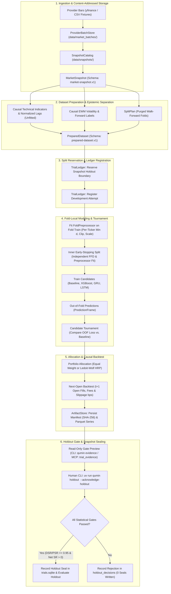

# Architecture, Econometric Methodology & Holdout Protocol

This document specifies Qumin's data lifecycle, econometric building blocks, fold-isolation mechanics, holdout gate state machine, and Phase 1 boundaries.

---

## 1. End-to-End Research Lifecycle

Qumin uses an imperative shell, functional core architecture:
- **Pure quantitative core (`src/lab/quant/`):** Stateless Polars/NumPy transforms for fractional differentiation, causal technical features, volatility/triple-barrier labeling, purged splits, Ledoit-Wolf Hierarchical Risk Parity (HRP), causal next-open backtesting, and PSR/DSR statistics.
- **Managed research & storage shell (`src/lab/research/`, `src/lab/platform/`):** Content-addressed Parquet snapshots, fold-local preprocessing orchestration, SQLite trial ledger (`trials.sqlite`), artifact persistence, and holdout gate enforcement.



---

## 2. Stage Mechanics & Timestamp Semantics

### Stage 1: Ingestion & Immutable Snapshotting
- Raw provider payloads are written verbatim to `data/market_batches/` with SHA-256 checksums.
- Published snapshots are registered in `SnapshotCatalog` (`data/snapshots/`) after verifying timestamp monotonicity, exchange trading calendar alignment (`exchange-calendars`), and configured gap policies (`reject` or `warn`).
- Pinning `data.source: "snapshot"` and `snapshot_id` freezes the exact input bars across all model comparisons.

### Stage 2: Unfitted `PreparedDataset`
`lab.research.preprocessing.prepare_dataset` combines an immutable `MarketSnapshot` into a `PreparedDataset` (`prepared-dataset.v1`) containing three strictly unfitted components:
1. **Causal Unfitted Features (`apply_all_features`):** Native Polars technical indicators (`ema5`, `macd`, `cdl2crows`, `wclprice`), dollar-volume metrics, and horizon-normalized multi-lag returns:
   $$\tilde{r}_{t, k} = (1 + r_{t, k})^{1/k} - 1$$
2. **Forward Labels (`compute_labels`):**
   - **Regression:** Forward open-to-open return from entry bar open ($t+1$) to exit bar open ($t+2$ or $t+1+h$).
   - **Classification (Triple Barrier):** Causal Exponentially Weighted Moving (EWM) volatility is estimated using closes up to bar $t$. Symmetric or asymmetric profit-taking and stop-loss barriers project forward across $[t+1, t+\text{expiry}]$, resolving exits causally at the subsequent bar open.
3. **Chronological Split Plan (`build_split_plan`):** Deterministic walk-forward development folds plus the trailing reserved holdout partition.

> **Why Preprocessing Is Deferred:** Fractional differentiation orders ($d$), quantile clipping thresholds, categorical vocabularies, and z-score standardizers depend on sample distributions. Fitting them when building `PreparedDataset` would leak future distribution moments into earlier folds. All statistical fitting is deferred to Stage 4 inside each fold.

### Stage 3 & 4: Purged Walk-Forward Splits, Per-Ticker FFD & Inner Early Stopping

```text
[========================== DEVELOPMENT PERIOD ==========================] [==== FINAL HOLDOUT ====]
[--- FOLD 0 TRAIN ---] [ V0 ]                                             (Reserved before training;
[------- FOLD 1 TRAIN -------] [ V1 ]                                      unseen during development;
[----------- FOLD 2 TRAIN -----------] [ V2 ]                              gated in trials.sqlite)
       \              /
   [Inner Train][Early Stop]
```

- **Per-Ticker Fold-Local FFD (`fit_preprocessor`):** On each fold's training slice $[t_{\text{train\_start}}, t_{\text{train\_end}})$, Qumin scans $d \in [0.1, 1.0]$ per ticker to find the minimum fixed-window fractional differencing order passing the Augmented Dickey-Fuller test ($p < 0.05$):
  $$(1 - B)^d = \sum_{k=0}^{\infty} w_k B^k, \quad w_0 = 1, \quad w_k = -w_{k-1} \frac{d - k + 1}{k}$$
  Fitted $d$ values, truncation windows, quantile clip bounds, and z-score scalers are stored in `preprocessors/fold-<k>.json` and applied to validation rows without refitting.
  *(Note: `find_global_d` in `src/lab/platform/dagster/assets.py` applies only to the standalone Dagster asset graph; the managed research engine always fits $d$ per ticker per training slice.)*
- **Independent Inner Early-Stopping Fit (`build_inner_stopping_data`):** When `models.early_stopping: true`, the fold training window splits chronologically into $[t_{\text{train\_start}}, t_{\text{stop\_start}})$ and $[t_{\text{stop\_start}}, t_{\text{train\_end}})$. A separate `FoldPreprocessor` (including independent per-ticker FFD $d$, clipping, and scaling) is fitted strictly on $[t_{\text{train\_start}}, t_{\text{stop\_start}})$ to select optimal boosting rounds or epochs without touching outer validation data $V_k$.
- **Purging vs. Embargo in Walk-Forward Splits:**
  - **Purging (Active):** Any training sample whose forward label horizon $t_1$ reaches or crosses validation start ($t_1 \ge t_{\text{val\_start}}$) is purged from the training fold.
  - **Embargo (`embargo_bars: 0`):** Because walk-forward training strictly precedes validation ($t_{\text{train\_end}} = t_{\text{val\_start}}$), there are zero post-validation training rows to embargo in the managed walk-forward runner (setting `splits.embargo_bars > 0` raises `ValueError`). For non-walk-forward combinatoric or K-fold schemes where training resumes after validation, use `PurgedKFold` in `src/lab/quant/cv.py`, which supports positive `embargo_bars`.
- **Perturbation regression checks (`tests/test_future_perturbation.py`):** On a controlled fixture, the test changes OHLCV data at and after each training cutoff. It checks equal preprocessor state and training keys, numerically close training arrays, matching XGBoost stopping duration and diagnostics, and numerically close predictions on the original training inputs.

### Stage 5: Portfolio Construction & Causal Execution Accounting
- **Ledoit-Wolf HRP (`src/lab/quant/hrp.py`):** Estimates shrunk asset return covariances via Ledoit-Wolf shrinkage, performs hierarchical tree clustering and quasi-diagonalization, and allocates capital via recursive bisection subject to `min_position_size`, `max_position_size`, and `gross_limit`.
- **Next-Open Execution (`src/lab/quant/backtest.py`):** Signals generated from bar $t$ close execute at bar $t+1$ open, deducting configurable notional `fees_bps` and `slippage_bps`.

---

## 3. Holdout Gate State Machine & Ledger Semantics

Before any development model trains on a snapshot, `TrialLedger` (`artifacts/trials.sqlite`) records the snapshot's holdout boundaries in `snapshot_reservations`.

To request holdout evaluation via CLI (`uv run qumin holdout <run_id> --acknowledge-holdout`), `evaluate_gate` (`src/lab/research/holdout_gate.py`) executes the following checks in exact order:

1. **Candidate & Sample-Key Alignment:**
   - Both `baseline` and the selected model must have completed status and identical out-of-fold sample counts (`n`).
   - Otherwise returns `REJECTED_INSUFFICIENT_EVIDENCE` (`BASELINE_OR_WINNER_UNAVAILABLE` or `BASELINE_SCORING_COVERAGE_MISMATCH`).
2. **Strict Out-of-Fold Loss Improvement Over Baseline:**
   - Regression compares out-of-fold `mse`; classification compares out-of-fold `log_loss` against the empirical prior baseline.
   - If `winner_loss >= baseline_loss`, returns `REJECTED_BY_BASELINE` (`WINNER_DID_NOT_STRICTLY_BEAT_BASELINE`).
3. **Return Series & Multi-Trial Variance Sufficiency:**
   - Requires a non-empty, all-finite net return series with at least $\max(30, \text{min\_observations})$ observations.
   - For single-trial runs ($K \le 1$), computes the Probabilistic Sharpe Ratio (PSR) against benchmark $SR^* = 0$.
   - For multi-trial runs ($K > 1$), requires at least $2$ comparable completed candidate attempts with positive finite sample variance $V$ across candidate Sharpe ratios (`FEWER_THAN_TWO_COMPARABLE_CANDIDATES` or `COMPARABLE_SHARPE_VARIANCE_UNAVAILABLE` $\rightarrow$ `REJECTED_INSUFFICIENT_EVIDENCE`), then computes the Deflated Sharpe Ratio (DSR):
     $$\text{DSR} = \text{PSR}\!\left(\sqrt{V}\left[(1 - \gamma)\Phi^{-1}\!\left(1 - \frac{1}{K}\right) + \gamma\Phi^{-1}\!\left(1 - \frac{1}{K e}\right)\right]\right)$$
     where $\gamma$ is the Euler-Mascheroni constant and $K$ is the count of canonical tested candidate configurations on the snapshot.
4. **Positive Net Sharpe & Confidence Threshold ($\ge 0.95$):**
   - If annualized out-of-fold net Sharpe $\le 0.0$, returns `REJECTED_BY_DSR` (`NONPOSITIVE_NET_SHARPE`).
   - If statistical score $< 0.95$, returns `REJECTED_BY_DSR` (`SCORE_BELOW_THRESHOLD`).
   - Only when score $\ge 0.95$ does the gate return `PASSED` (`GATE_PASSED`).

### Sealing & Local Integrity Model
- **Rejected requests** record an immutable decision row in `holdout_decisions` and write zero rows to `holdout_seals`. The holdout partition is never evaluated.
- **Accepted requests** insert a seal for `snapshot_hash` into `holdout_seals` (tracking execution lifecycle `reserved` $\rightarrow$ `running` $\rightarrow$ `completed`/`failed`/`interrupted`) and block any future development registrations against that `snapshot_hash`.
- **Threat Model Honesty:** Qumin uses SHA-256 content hashes (snapshots, configs, run manifests) and SQLite immutability triggers on `trials` and terminal `attempts` to enforce deterministic provenance and accidental-leakage prevention. Deleting `artifacts/trials.sqlite` resets local software state (Qumin has no DRM or hardware enclave), though it cannot restore statistical validity once a human or agent has inspected holdout outcomes.

---

## 4. Phase 1 Known Epistemic Boundaries (Statistical Negative Control)

Phase 1 is a statistical negative control designed to expose false discoveries from human p-hacking or autonomous coding agents:

1. **Equity Universe & `yfinance` Limitations:**
   - Manually curated symbol lists (`config/tickers.yaml`) and free `yfinance` daily OHLCV streams do not include delisted equities and are subject to survivorship bias and upstream split/dividend restatements if re-fetched (`data.source: "provider"`).
   - Pinning `data.source: "snapshot"` guarantees exact numerical reproducibility across runs; it does not provide survivorship-free institutional point-in-time constituent membership.
2. **Linear Basis-Point Cost Model:**
   - Phase 1 deducts flat notional `fees_bps` and `slippage_bps` at $t+1$ open. It does not yet model square-root market impact, intraday bid-ask spread regimes, L2 queue position, or adverse selection (scheduled for Stage 2 order-book microstructure extensions).
3. **Conservative Unclustered $K$ in DSR:**
   - `trial_count` ($K$) counts distinct canonical candidate configurations tested against the snapshot. When sweeping highly correlated hyperparameters, unclustered $K$ is slightly conservative relative to effective independent trials ($K_{\text{eff}} \le K$ via eigen-clustering, planned on the roadmap).
